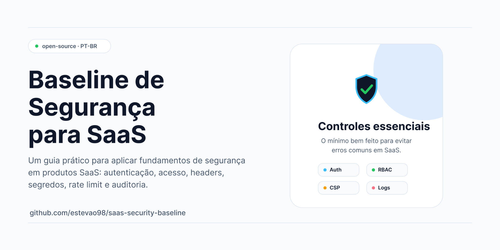
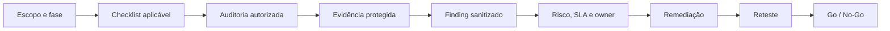

<p align="center">
  
</p>

# SaaS Security Baseline

<p align="center">
  <strong>Baseline reutilizável para segurança, governança, privacidade, acessibilidade, evidências e maturidade técnica de produtos SaaS.</strong>
</p>

<p align="center">
  <a href=".github/workflows/security.yml"></a>
  <a href="docs/security-roadmap.md"></a>
  <a href="docs/evidence-and-reporting-policy.md"></a>
  <a href="research/task-queue.md"></a>
</p>

---

## Visão geral

Este repositório transforma referências de segurança e governança em um fluxo prático para SaaS:

1. definir escopo, stack, owners e maturidade;
2. selecionar controles, checklists e auditorias aplicáveis;
3. executar verificações locais autorizadas;
4. proteger evidências e relatórios;
5. classificar riscos, findings e exceções;
6. acompanhar remediação, reteste e decisão de release.

> **Importante:** esta baseline não é certificação, parecer jurídico, pentest ofensivo, prova de conformidade ou garantia de ausência de vulnerabilidades. Ela organiza o trabalho; a validação real depende do SaaS consumidor, do contexto técnico, jurídico, contratual e operacional.

---

## Navegação rápida

| Preciso de... | Comece por aqui |
|---|---|
| Entender a estrutura do repositório | [`docs/repository-architecture.md`](docs/repository-architecture.md) |
| Definir fase de maturidade | [`docs/security-roadmap.md`](docs/security-roadmap.md) |
| Escolher quando auditar | [`docs/audit-trigger-matrix.md`](docs/audit-trigger-matrix.md) |
| Ver ferramentas e limitações | [`docs/security-tools-catalog.md`](docs/security-tools-catalog.md) |
| Rodar scripts locais | [`scripts/README.md`](scripts/README.md) |
| Classificar severidade, risco e SLA | [`risk/severity-and-prioritization.md`](risk/severity-and-prioritization.md) |
| Proteger evidências e relatórios | [`docs/evidence-and-reporting-policy.md`](docs/evidence-and-reporting-policy.md) |
| Preparar relatório final | [`docs/security-audit-baseline.md`](docs/security-audit-baseline.md) |
| Usar checklists | [`checklists/`](checklists/) |
| Copiar templates | [`templates/`](templates/) |
| Ver histórico da pesquisa | [`research/`](research/) |

---

## O que este baseline cobre

| Domínio | Conteúdo principal |
|---|---|
| **AppSec** | OWASP, autenticação, autorização, APIs, lógica de negócio, revisão manual e gates. |
| **DevSecOps** | GitHub Actions, branches, commits, PRs, permissões mínimas, artifacts e higiene de repositório. |
| **Supply chain** | Dependências, SCA, SBOM, containers, IaC, versões, telemetria e registros externos. |
| **Backend e Python** | Aplicações Python web, APIs, autorização server-side, jobs, SQL/ORM, arquivos e isolamento multi-tenant. |
| **Privacidade/LGPD** | Bases legais, ROPA, RIPD/DPIA, direitos dos titulares, terceiros, retenção e incidentes. |
| **Acessibilidade** | WCAG 2.2, avaliação manual, automação parcial, fluxos críticos e evidências. |
| **Risco e evidências** | Severidade, prioridade, aceite, exceção, redaction, armazenamento restrito e relatórios sanitizados. |
| **Operação** | Backups, incidentes, continuidade, fornecedores, releases e acompanhamento de remediação. |

---

## Estrutura do repositório

```txt
.
├── .github/workflows/              # Workflow ativo mínimo de higiene e política
├── accessibility/                  # Índice e materiais de acessibilidade
├── appsec/                         # Segurança de aplicação
├── business-continuity/            # Continuidade, backup e recuperação
├── checklists/                     # Checklists por domínio, fase e decisão
├── compliance/                     # Normas, frameworks e obrigações por contexto
├── devsecops/                      # CI/CD, supply chain e segurança de entrega
├── docs/                           # Guias, programas, matrizes e modelos centrais
├── examples/github-workflows/       # Exemplos não ativos de workflows
├── incident-response/              # Resposta a incidentes e postmortem
├── privacy/                        # LGPD, dados pessoais e terceiros
├── reports/                        # Separação entre raw local e sanitized revisado
├── research/                       # Planejamento, fontes, progresso e inventário
├── risk/                           # Severidade, priorização e risco auxiliar
├── scripts/                        # Wrappers locais defensivos
├── security/                       # Índices e políticas de segurança
├── templates/                      # Modelos reutilizáveis, fictícios ou preenchíveis
└── testing/                        # Fixtures fictícias e validações locais
```

A explicação detalhada da arquitetura está em [`docs/repository-architecture.md`](docs/repository-architecture.md).

---

## Como aplicar em um SaaS novo

1. Crie um repositório privado a partir desta baseline.
2. Defina produto, stack, ambientes, owners, revisores e fase de maturidade.
3. Configure responsáveis reais no [`CODEOWNERS`](CODEOWNERS).
4. Escolha os checklists aplicáveis e registre itens não aplicáveis.
5. Copie templates para um sistema de trabalho adequado, não para dados reais dentro desta baseline.
6. Valide ferramentas, versões, rede, telemetria, permissões e saídas antes de rodar scripts.
7. Mantenha evidências cruas fora do Git e publique somente resumos sanitizados revisados.

```bash
# exemplo mínimo: auditoria local restrita a secrets
AUDIT_COMPONENTS=secrets ./scripts/run-security-audit.sh
```

---

## Como aplicar em um SaaS existente

1. Inventarie arquitetura, dados, tenants, dependências, integrações e releases.
2. Use a [`Matriz de gatilhos`](docs/audit-trigger-matrix.md) para priorizar auditorias.
3. Execute verificações somente em ambiente autorizado, sem dados reais e sem segredos no workspace.
4. Registre findings com IDs opacos, impacto, owner, SLA, gate e critério de reteste.
5. Transforme lacunas recorrentes em controles de CI/CD, políticas e revisões periódicas.
6. Avance a maturidade somente quando os critérios estiverem sustentáveis.

---

## Maturidade recomendada

| Fase | Objetivo | Prioridades |
|---|---|---|
| **MVP seguro** | Reduzir riscos óbvios antes de beta e produção. | Segredos, autenticação, autorização, dependências, backups, logs, privacidade básica, acessibilidade de fluxos críticos e gates mínimos. |
| **SaaS vendável para empresas** | Produzir governança e evidências consistentes. | CI/CD estável, SAST/SCA, SBOM, terceiros, incidentes, continuidade, LGPD, acessibilidade e controles de release. |
| **SaaS maduro** | Operar controles contínuos, mensuráveis e auditáveis. | Gestão de risco integrada, supply chain, segregação, monitoramento, exercícios, métricas, auditoria independente e certificação quando houver objetivo formal. |

Planos de **30, 60, 90 e 180 dias**: [`docs/security-roadmap.md`](docs/security-roadmap.md).

---

## Fluxo de trabalho sugerido



Se o GitHub não renderizar Mermaid no contexto usado, consulte o mesmo fluxo em forma textual nos documentos de `docs/`, `risk/` e `reports/`.

---

## Scripts locais

Os scripts são wrappers defensivos. Eles não instalam ferramentas, não corrigem código, não devem rodar contra produção e separam saída crua de resumo sanitizado.

| Script | Uso |
|---|---|
| [`run-security-audit.sh`](scripts/run-security-audit.sh) | Orquestra verificações locais selecionadas. |
| [`run-python-audit.sh`](scripts/run-python-audit.sh) | Bandit, Semgrep local e pip-audit com consentimento de rede. |
| [`run-node-audit.sh`](scripts/run-node-audit.sh) | Auditoria Node/npm/pnpm com consentimento explícito. |
| [`run-accessibility-audit.sh`](scripts/run-accessibility-audit.sh) | Pa11y/Lighthouse em URL loopback. |
| [`run-api-audit.sh`](scripts/run-api-audit.sh) | Schemathesis/ZAP em alvo local autorizado. |
| [`run-container-audit.sh`](scripts/run-container-audit.sh) | Trivy, Grype e Checkov conforme escopo. |
| [`generate-sbom.sh`](scripts/generate-sbom.sh) | SBOM CycloneDX/SPDX com Syft. |

Leia antes de executar: [`scripts/README.md`](scripts/README.md).

---

## CI/CD e GitHub Actions

O workflow ativo padrão é [`security.yml`](.github/workflows/security.yml). Ele valida higiene documental e regras mínimas de segurança do repositório:

- `permissions: contents: read`;
- sem `pull_request_target`;
- sem secrets;
- sem upload de artifacts;
- sem scanners pesados ou dependentes de plano;
- sem declarar ausência de vulnerabilidades.

Os arquivos em [`examples/github-workflows/`](examples/github-workflows/) são exemplos não ativos. Antes de promover qualquer um para `.github/workflows/`, valide stack, plano GitHub, permissões, SHA/digest, logs, artifacts, retenção e política de falha.

---

## Evidências, relatórios e segredos

A regra central é simples:

> Git não é cofre de evidência sensível.

| Local | Política |
|---|---|
| `reports/raw/` | Saídas integrais locais. Fora do Git por padrão. |
| `reports/sanitized/` | Apenas sínteses minimizadas, redigidas e revisadas. |
| Issues e PRs | Contexto seguro, IDs opacos e sem detalhe explorável. |
| Artifacts de CI | Evitar; usar somente quando indispensável, enumerado e com retenção curta. |

Se um segredo real for encontrado, não preserve o valor em Git. Revogue/rotacione, registre apenas o mínimo necessário em canal restrito e avalie exposição histórica. Apagar a linha não encerra o incidente.

Política completa: [`docs/evidence-and-reporting-policy.md`](docs/evidence-and-reporting-policy.md).

---

## Checklists principais

| Grupo | Checklists |
|---|---|
| Release | [`pre-beta`](checklists/pre-beta.md), [`pre-deploy`](checklists/pre-deploy.md), [`pre-enterprise-sale`](checklists/pre-enterprise-sale.md) |
| AppSec | [`OWASP Top 10`](checklists/owasp-top-10.md), [`OWASP ASVS`](checklists/owasp-asvs.md), [`OWASP API Top 10`](checklists/owasp-api-top-10.md) |
| Plataforma | [`cloud`](checklists/cloud-security.md), [`CI/CD`](checklists/ci-cd-security.md), [`pagamentos`](checklists/payment-security.md) |
| Governança | [`LGPD`](checklists/lgpd.md), [`acessibilidade`](checklists/accessibility-wcag-22-aa.md), [`terceiros`](checklists/third-party-risk.md), [`incidentes`](checklists/incident-response.md), [`backup`](checklists/backup-restore.md), [`IA`](checklists/ai-governance.md) |

Checklist preenchido pode revelar arquitetura, lacunas e dados operacionais. Trate conforme a política de evidências.

---

## Templates

O índice de templates reúne modelos de:

- finding;
- remediação;
- risco;
- resumo executivo;
- mapa de dados;
- ROPA;
- RIPD/DPIA;
- incidentes;
- postmortem;
- fornecedores;
- acessibilidade;
- threat modeling;
- governança de IA.

Consulte [`templates/index.md`](templates/index.md). Preencha cópias em local autorizado e com classificação adequada.

---

## Estado do baseline

A fila corretiva do repositório foi concluída:

| Lote | Status |
|---|---|
| Lote 1 — Estrutura inicial | Concluído |
| Lote 2 — Documentos base | Concluído |
| Lote 3 — Checklists | Concluído |
| Lote 4 — Políticas | Concluído |
| Lote 5 — Scripts | Concluído |
| Lote 6 — GitHub Actions | Concluído |
| Lote 7 — Backend/Python | Concluído |
| Lote 8 — LGPD | Concluído |
| Lote 9 — Acessibilidade | Concluído |
| Lote 10 — Relatórios e evidências | Concluído |
| Lote 11 — Revisão final | Concluído |

Detalhes: [`research/task-queue.md`](research/task-queue.md), [`research/progress.md`](research/progress.md) e [`research/repository-inventory.md`](research/repository-inventory.md).

Pendências restantes são contextuais do SaaS consumidor: owners reais, canal privado, plano GitHub, versões de ferramentas, validação jurídica, armazenamento restrito, testes reais autorizados e promoção de gates especializados.

---

## O que não fazer

- Não commitar tokens, cookies, senhas, chaves privadas, `.env`, dumps, backups ou `site_config.json`.
- Não versionar logs crus, relatórios integrais, screenshots sem redaction, requests/responses ou DOM real.
- Não executar scanners contra produção, terceiros ou alvos sem autorização explícita.
- Não tratar resultado limpo de scanner como prova de segurança.
- Não habilitar workflows especializados sem validar permissões, artifacts, retenção, logs, plano GitHub e política de falha.
- Não preencher templates centrais com dados de cliente, tenant, fornecedor ou ambiente real.

---

## Contribuição

Mudanças devem ser pequenas, revisáveis e vinculadas a um objetivo claro.

Antes de abrir PR:

1. confirme o escopo;
2. preserve links internos;
3. não adicione evidência sensível;
4. rode checks aplicáveis;
5. revise o diff contra segredos e dados reais;
6. peça revisão do owner competente quando envolver risco, privacidade, acessibilidade, CI/CD ou política.

Guia operacional: [`CONTRIBUTING.md`](CONTRIBUTING.md). Reporte privado: [`SECURITY.md`](SECURITY.md).

---

## Fontes e rastreabilidade

A pesquisa, decisões e reconciliações estão registradas em:

- [`research/sources/`](research/sources/);
- [`research/coverage-audit.md`](research/coverage-audit.md);
- [`research/codex-execution-plan.md`](research/codex-execution-plan.md);
- [`research/task-queue.md`](research/task-queue.md);
- [`research/progress.md`](research/progress.md);
- [`research/repository-inventory.md`](research/repository-inventory.md).

As fontes oficiais e incertezas estão organizadas em [`docs/standards-and-frameworks-matrix.md`](docs/standards-and-frameworks-matrix.md).

---

## Licença e uso

Este repositório é uma baseline de trabalho. Antes de reutilizar em outro produto ou organização, revise permissões, contratos, classificação das informações e requisitos legais aplicáveis.
